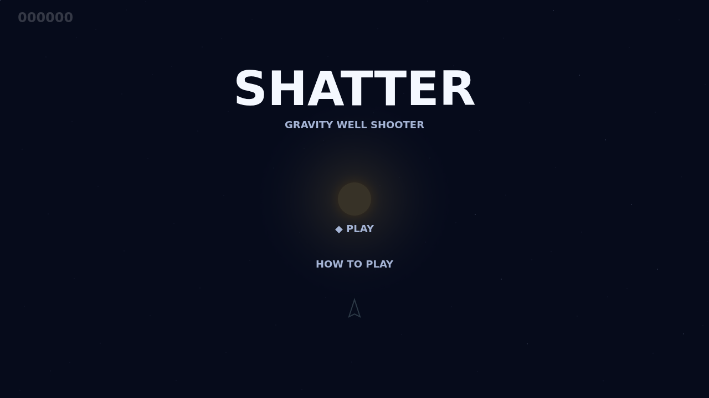
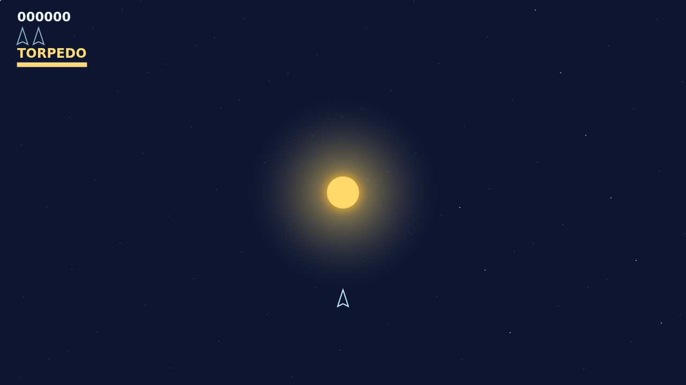

# Shatter

Shatter is a fast, momentum-driven rock shooter set around a hungry gravity well. Every wave fills the wrapping field with armored rocks that must be chipped apart, split by split, until the last fragments disappear.

The star changes every shot. Gunfire bends toward its centre, while your ship stays under direct control. A careful pilot can send a round around the well and reach a rock on the far side; a careless one can let the core swallow a rock and send it back in from an unexpected edge.

When a rock will not break in time, fire the Warhead torpedo. It flies true through the well, homes onto a body in its forward cone, and destroys the target outright. Between waves, an armed saucer arrives to hunt you, so the arena is never quiet for long.

